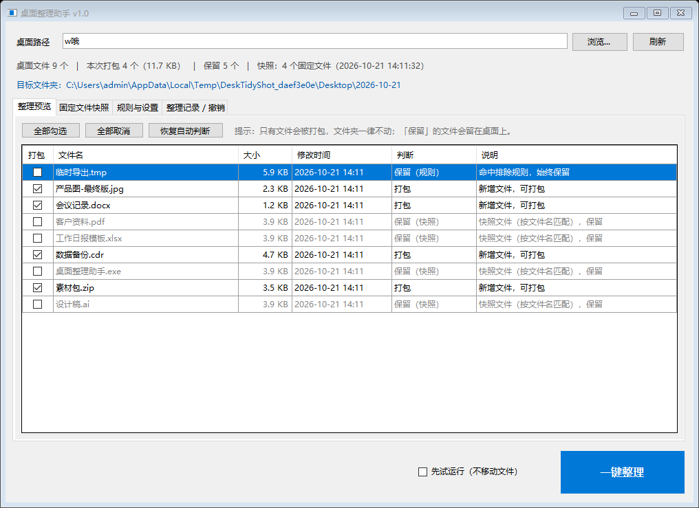
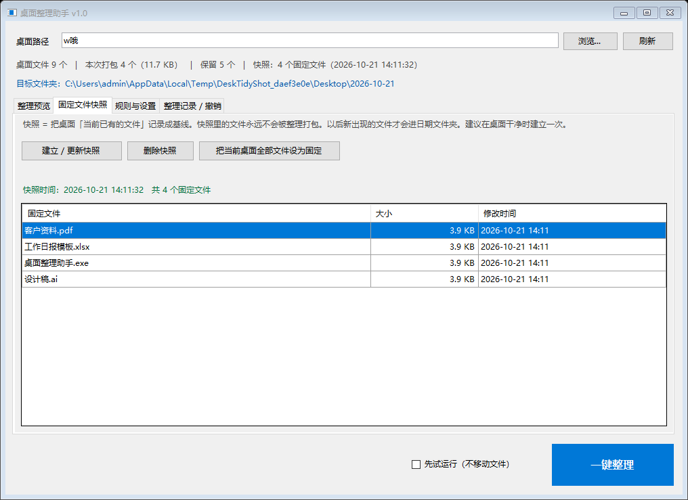
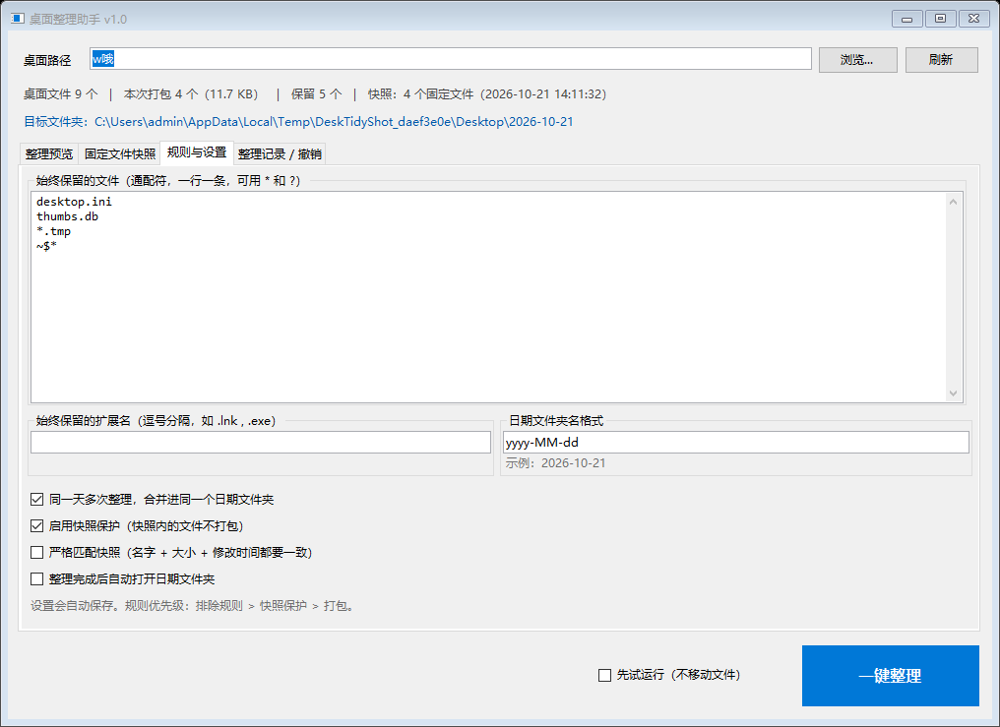
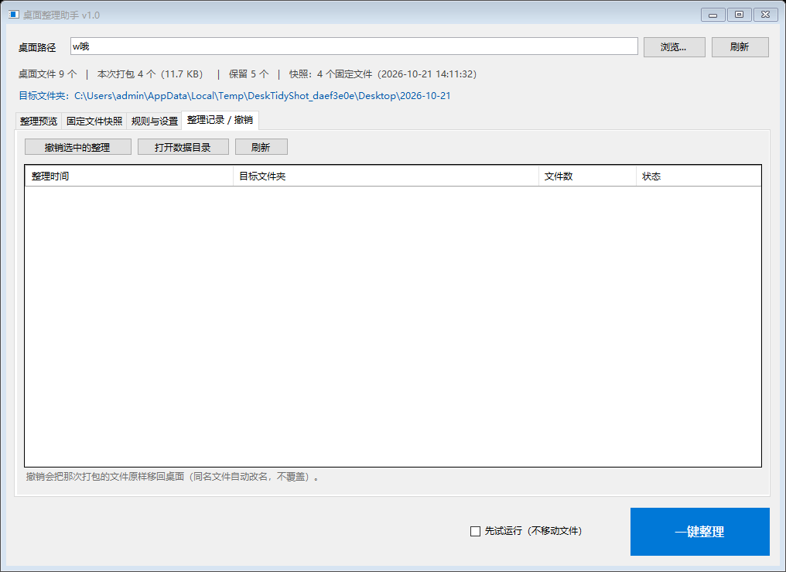

# 桌面整理助手 DeskTidy

把桌面上的**新文件**一次性收进以当天日期命名的文件夹，每天固定要用的文件用**快照**钉在桌面不动。

一个 62 KB 的单文件 Windows 小程序：双击即用，不装运行时、不写注册表、不联网、不后台常驻。

## 下载

**[⬇ 下载 桌面整理助手.exe](https://github.com/WWZTT/desktidy/raw/main/dist/%E6%A1%8C%E9%9D%A2%E6%95%B4%E7%90%86%E5%8A%A9%E6%89%8B.exe)** —— 62,976 字节，单文件绿色版，下载后双击即用。

- 或从仓库文件页打开 [`dist/桌面整理助手.exe`](dist/桌面整理助手.exe) 点「Download raw file」。
- 运行环境：Windows 7 SP1 及以上 + .NET Framework 4.x（Windows 10 / 11 自带，无需另行安装）。
- **exe 未做代码签名**，首次运行 Windows SmartScreen 可能提示「已保护你的电脑」：点「更多信息」→「仍要运行」即可。不放心就按下文自行编译，源码全部在这个仓库里。
- SHA256：`e1dc189c021034a723745fbce5d5df0e5cf42fd60ec615c1c0e8ab3c2e349143`（对应仓库内这一份 exe；自行重新编译后哈希会变，属正常现象）

## 整理前 / 整理后

整理前 —— 桌面混着固定文件、今天的新文件和一个文件夹：

```
桌面/
├── 工作日报模板.xlsx      （快照内 → 不动）
├── Chrome.lnk             （快照内 → 不动）
├── 会议记录.docx          （今天新增 → 打包）
├── 产品图-最终版.jpg      （今天新增 → 打包）
├── 素材包.zip             （今天新增 → 打包）
└── 进行中的项目/          （文件夹 → 永不移动）
```

整理后：

```
桌面/
├── 工作日报模板.xlsx
├── Chrome.lnk
├── 进行中的项目/
└── 2026-10-21/            ← 以当日日期命名
    ├── 会议记录.docx
    ├── 产品图-最终版.jpg
    └── 素材包.zip
```

## 截图



| 固定文件快照 | 规则与设置 |
|---|---|
|  |  |

| 整理记录 / 撤销 |
|---|
|  |

## 快速上手

[下载 exe](#下载) → 双击 → 三步：

1. 切到「**固定文件快照**」，点「建立 / 更新快照」——此刻桌面上的所有文件都被记为"固定"，以后不会被打包。
2. 点「**刷新**」，切到「整理预览」看每个文件的判定结果，勾选框可逐个改。
3. 点右下角「**一键整理**」。之后每天新出现的文件会被收进 `2026-10-21` 这样的日期文件夹。

不确定效果就先勾上「先试运行（不移动文件）」，只演算不动手。

## 设计要点

### "新文件"怎么判定：快照

用户不可能每天手动维护"这些是我要留的"。所以程序只在**用户按下的那一刻**记录一次快照（文件名 + 大小 + 修改时间），此后：

- 在快照里 → 保留
- 不在快照里 → 视为新增，打包

快照是用户显式按下的"基线"，不是程序猜的。想加入固定项就重新建一次快照，想全部放开就删掉快照。

两种匹配强度：

| 模式 | 判定 | 适用 |
|---|---|---|
| 宽松（默认） | 只比文件名 | 每天都在编辑的文档（`工作日报.xlsx`）改完仍在桌面 |
| 严格 | 名字 + 大小 + 修改时间都一致 | 同名文件被替换过就当新文件处理 |

### 判定优先级

每个桌面顶层文件按固定优先级流水线判定（`src\Organizer.cs` 的 `BuildPlan`）：

```
命中排除规则  →  保留（规则最明确，优先级最高）
   ↓ 否
命中快照      →  保留
   ↓ 否
打包进日期文件夹
```

**文件夹不参与判定**，永远不动，里面的文件也不动。这是硬约束不是过滤条件——扫描阶段只用 `Directory.GetFiles`，目录从不进入候选集，因此在类型层面就不可能被 `File.Move` 搬走。

界面上可以手动勾选/取消单个文件，手动值优先于自动判定；把勾选改回原样时条目会重新回到"自动判定"状态，之后改规则依然对它生效。

### 安全兜底

- **`File.Move` 原子改名**，桌面 → 桌面子目录同卷移动，不复制、不删除、不占额外空间。
- **每次整理留撤销日志**，可一键把那次打包的文件原样搬回桌面。
- **撤销绝不覆盖**：桌面已有同名文件时自动改名成 `另一个 (1).txt`。
- **试运行**：勾上后点整理只统计不动手。
- **逐文件容错**：某个文件被 Word 占用而移动失败，只记录该条错误，不中断整批。
- **配置损坏不致命**：`config.json` 解析失败自动回落默认值，不会变成启动失败。

## 界面

| 标签页 | 作用 |
|---|---|
| 整理预览 | 每个文件一行：勾选框 / 文件名 / 大小 / 修改时间 / 判断 / 说明；全部勾选、全部取消、恢复自动判断 |
| 固定文件快照 | 建立、更新、删除快照；一键「把当前桌面全部文件设为固定」 |
| 规则与设置 | 文件名通配规则、扩展名黑名单、日期格式（带实时示例）、同日复用、快照保护、严格匹配、整理后自动打开 |
| 整理记录 / 撤销 | 历史列表 + 撤销选中；打开数据目录 |

底部：「先试运行」开关 +「一键整理」。

## 数据位置

```
%AppData%\DeskTidy\
    config.json      设置（界面改动即时保存）
    snapshot.json    快照基线
    logs\            每次整理与撤销的日志
```

不写注册表。删掉 exe 即卸载；把整个 `%AppData%\DeskTidy` 拷走即可迁移到别的机器。

## 构建

需要 Windows 自带的 .NET Framework 编译器，**不需要** Visual Studio 或 dotnet SDK：

```
C:\Windows\Microsoft.NET\Framework64\v4.0.30319\csc.exe
```

```powershell
powershell -ExecutionPolicy Bypass -File build.ps1            # 编译 + 三层测试
powershell -ExecutionPolicy Bypass -File build.ps1 -SkipUiTest   # 无人值守/无桌面会话
powershell -ExecutionPolicy Bypass -File build.ps1 -Clean        # 清空 obj、dist 重建
```

产物：`dist\桌面整理助手.exe`（62 KB）+ `dist\使用说明.txt`。

> `build.ps1` 必须以 **UTF-8 with BOM** 保存。Windows PowerShell 5.1 读取无 BOM 脚本时按系统 ANSI 代码页解码，中文会乱码并导致语法错误。

## 测试

`build.ps1` 默认跑三层测试，任一层失败即中断构建：

| 层 | 数量 | 内容 |
|---|---:|---|
| 逻辑自测（无窗口） | 60 项 | 日期格式与非法字符清洗、排除规则、方案构建、快照保护、严格匹配、执行与撤销、同名冲突、文件夹永不打包、同日复用目录 |
| 界面布局检查 | 0 问题 | 遍历四个标签页断言控件尺寸非零且不越界、关键控件存在、表格列宽不溢出；最小窗口尺寸下重跑 |
| 端到端流程 | 31 项 | 沙箱桌面里真实点按钮走完 建快照 → 刷新 → 手动勾选 → 一键整理 → 撤销 → 试运行，消息框自动应答 |

逻辑层 `Organizer` 不引用 `System.Windows.Forms`，因此 60 项自测能在无窗口会话的环境里跑。报告输出到 `obj\ui-layout.txt`、`obj\ui-flow.txt`。

## 项目结构

```
src/                 应用源码
  Model.cs           配置 / 快照 / 撤销日志的模型与持久化，通配符，文件系统工具
  Organizer.cs       方案构建、执行、撤销 —— 纯逻辑，无 UI 依赖
  MainForm.cs        WinForms 主窗口（四标签页 + 底部操作条）
  Program.cs         入口，全局异常兜底
  SelfTest.cs        60 项无头逻辑自测
  TestMain.cs        自测控制台入口（不进发布产物）
  app.manifest       执行级别 + DPI + 长路径 + 视觉样式
  AssemblyInfo.cs    程序集信息
tools/               仅测试/构建用的工具，不发布
  IconGen.cs         程序化生成多尺寸 ICO
  UiSelfCheck.cs     界面布局检查
  UiFlowTest.cs      端到端流程测试
  UiShot.cs          截图工具（手工运行）
docs/
  TECHNICAL.md       技术文档：选型、架构、算法、数据格式、缺陷复盘
  screenshots/       界面截图
dist/                构建产物（已随仓库提交，方便直接下载）
  桌面整理助手.exe    单文件绿色版
  使用说明.txt        面向最终用户的三步上手
build.ps1            构建脚本（UTF-8 with BOM）
```

## 技术栈

.NET Framework 4.8 · WinForms · 系统自带 `csc.exe`（C# 5）· `System.Web.Extensions` 的 `JavaScriptSerializer`

选它是因为产物小、无部署负担、目标机零依赖。详细对比与取舍见 [技术文档](docs/TECHNICAL.md#2-技术选型)。

## 已知边界

- 只整理桌面**第一层**；子文件夹里的文件不处理。
- 不监听文件系统变化，新文件需点「刷新」才出现在预览里。
- 不做开机自启、不后台常驻、无托盘图标。
- 跨卷移动不处理（`File.Move` 会失败并记入错误列表），本项目场景是桌面 → 桌面子目录，同卷。
- 界面为中文；高 DPI 下使用 System DPI Aware（单 EXE 无法携带 `app.config`，拿不到 Per-Monitor V2 的 WinForms 支持）。

## 文档

- [技术文档](docs/TECHNICAL.md) — 选型理由、架构分层、判定算法、数据格式、界面约束、构建与测试、两个真实缺陷复盘
- `dist\使用说明.txt` — 面向最终用户的三步上手（构建时生成）

## License

MIT
