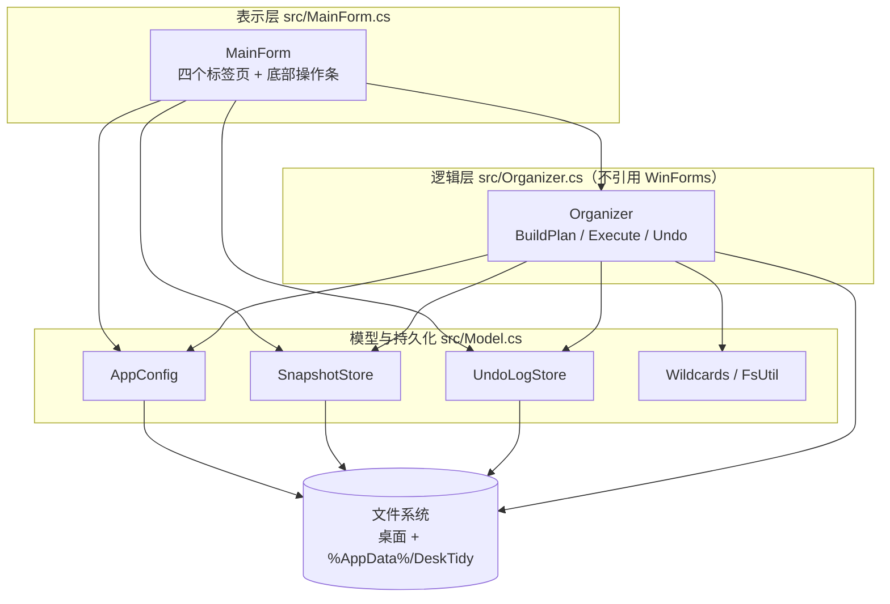
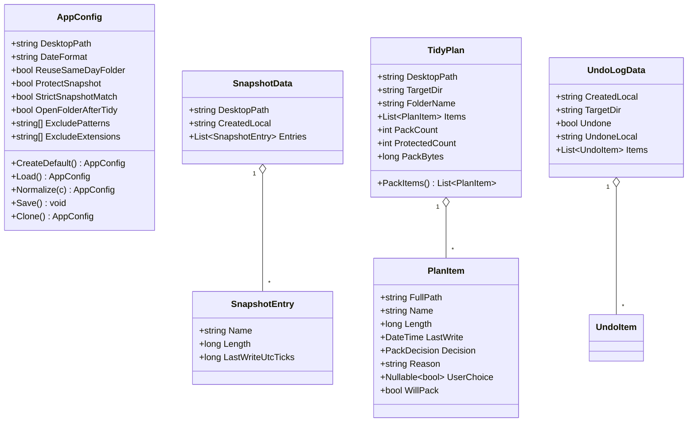
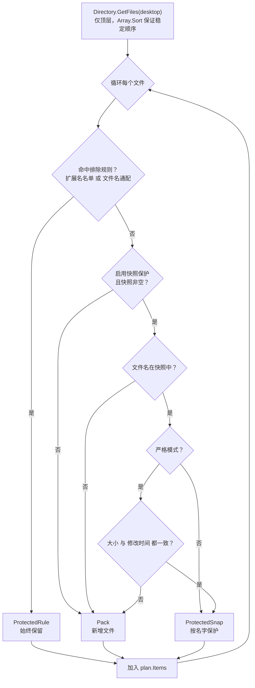
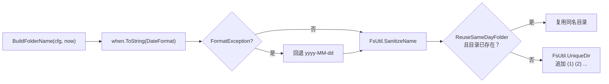
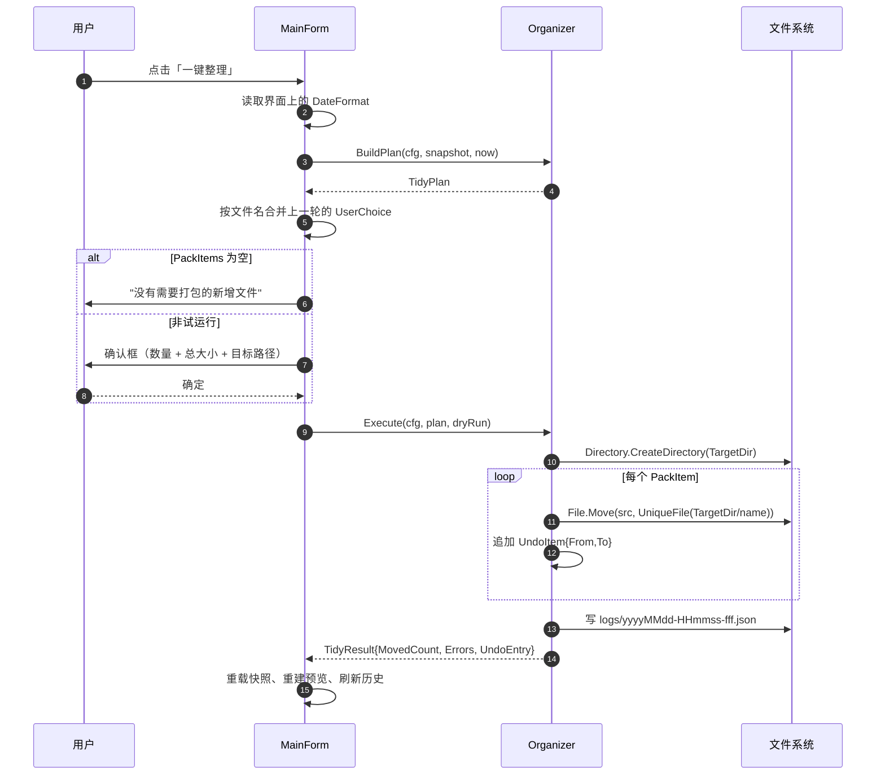
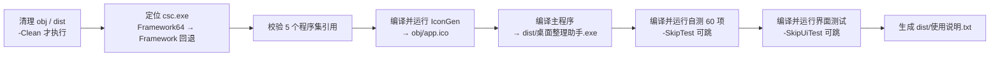

# 技术文档 · 桌面整理助手 DeskTidy

> 面向维护者与二次开发者的设计说明。用户向的快速上手见 [README](../README.md)。

本文档说明：为什么这样选型、代码怎么分层、判定算法如何保证"绝不误伤"、数据格式是什么、界面布局的约束从哪来、构建与测试如何闭环，以及开发过程中两个真实缺陷的复盘。

---

## 目录

- [1. 问题定义](#1-问题定义)
- [2. 技术选型](#2-技术选型)
- [3. 架构总览](#3-架构总览)
- [4. 核心模型](#4-核心模型)
- [5. 判定算法](#5-判定算法)
- [6. 执行与撤销](#6-执行与撤销)
- [7. 数据格式](#7-数据格式)
- [8. 界面实现](#8-界面实现)
- [9. 构建系统](#9-构建系统)
- [10. 测试体系](#10-测试体系)
- [11. 缺陷复盘](#11-缺陷复盘)
- [12. 已知边界与演进](#12-已知边界与演进)
- [13. 编码约定](#13-编码约定)

---

## 1. 问题定义

用户诉求可以拆成四条硬约束，后面的每个设计决定都从这四条推导：

| # | 约束 | 推论 |
|---|---|---|
| C1 | 把桌面**新添加**的文件收进以当日日期命名的文件夹 | 需要一个"什么算新增"的判定基线 → 快照 |
| C2 | 有些文件每天固定要用，不能被打包 | 基线必须能被用户显式冻结、可重建 |
| C3 | 只打包**文件**，不含文件夹 | 扫描不能递归，`Directory.GetDirectories` 的结果不进入判定流程 |
| C4 | 单 EXE、带界面 | 不能依赖安装器、运行时不需额外部署 |

C3 是安全边界里最容易被写错的一条：一旦把 `Directory.GetDirectories` 混进候选集，`File.Move` 会连带搬走整个子树，而"撤销"只能逐条记录文件、无法还原目录结构。因此本项目的结构是**方案（Plan）与执行（Execute）都只接受文件路径**，目录在扫描阶段就被排除在类型之外，而不是靠过滤条件挡掉。

---

## 2. 技术选型

### 2.1 候选对比

| 方案 | 产物 | 体积 | 目标机要求 | 结论 |
|---|---|---|---|---|
| **.NET Framework 4.8 + WinForms + 系统 `csc.exe`** | 单 exe | **62 KB** | Win10/11 自带 4.8；Win7 装 4.5+ | ✅ 采用 |
| .NET 6/7 单文件发布 | 单 exe | ~60 MB | 无（自包含） | ❌ 体积是需求的 1000 倍，启动慢 |
| Python + tkinter + PyInstaller | 单 exe | ~10–15 MB | 无 | ❌ 体积大，且易被启发式杀软误报 |
| Electron / Tauri | 安装包 | 50 MB+ | 无 | ❌ 为四个标签页付这个代价不值 |
| 汇编级 Win32 API | 单 exe | < 50 KB | 无 | ❌ 开发与维护成本远超收益 |

### 2.2 为什么是 `csc.exe` 而不是 MSBuild / `dotnet build`

- `C:\Windows\Microsoft.NET\Framework64\v4.0.30319\csc.exe` 是 Windows 自带的 C# 5 编译器，**任何一台目标机都能编译**，构建链零外部依赖。
- 不引入 `.csproj`、NuGet、SDK 版本约束，`build.ps1` 一条命令从零产出 exe。
- 代价：语言特性锁在 C# 5（无 `async/await`、无字符串插值 `$""`、无名值元组、无 `nameof`、无表达式体成员）。本项目是同步的小体量桌面工具，这个限制没有实际伤害。
- JSON 使用 `System.Web.Script.Serialization.JavaScriptSerializer`（`System.Web.Extensions.dll`），同样随框架自带，避免引入 Newtonsoft.Json 这类外部依赖。

### 2.3 单 EXE 的代价

WinForms 的高 DPI 行为依赖 `app.config` 里的 `System.Windows.Forms.ApplicationConfigurationSection`。单 exe 无法携带配置文件，因此**不能**声明 Per-Monitor V2——声明了也拿不到 WinForms 的对应支持，只会让高 DPI 下的布局按物理像素计算而失控。

实际做法见 `src\app.manifest`：只用 manifest 内的 `dpiAware=true`（System DPI Aware），并保留 `longPathAware`（>260 字符路径）与 Common-Controls 6.0（视觉样式）。

---

## 3. 架构总览

### 3.1 分层与依赖方向



依赖是单向的：`Organizer` 不 `using System.Windows.Forms`。这一条不是洁癖，而是让 60 项逻辑自测能在**没有窗口会话**的环境下跑（CI、远程 shell、`-SkipUiTest`）。界面测试则单独编译 `MainForm.cs` 进测试宿主。

### 3.2 文件职责

| 文件 | 约行数 | 职责 |
|---|---:|---|
| `src\Model.cs` | 409 | 路径约定、JSON 封装、`AppConfig`、快照与撤销日志的存取、通配符、文件系统工具 |
| `src\Organizer.cs` | 359 | `PackDecision` / `PlanItem` / `TidyPlan` / `TidyResult`，方案构建、执行、撤销——纯逻辑 |
| `src\MainForm.cs` | 1011 | 全部界面构建、事件处理、状态刷新 |
| `src\Program.cs` | 36 | 入口、数据目录初始化、未处理异常兜底 |
| `src\SelfTest.cs` | 368 | 60 项无头逻辑自测，临时沙箱内运行并清理 |
| `src\TestMain.cs` | 14 | 自测控制台入口（不参与正式 exe） |
| `src\app.manifest` | 32 | 执行级别、OS 兼容、DPI、长路径、视觉样式 |
| `src\AssemblyInfo.cs` | 11 | 程序集元数据与版本 |
| `tools\IconGen.cs` | 130 | 程序化绘制 7 个尺寸的 ICO（不依赖外部资源） |
| `tools\UiSelfCheck.cs` | 198 | 界面布局检查 |
| `tools\UiFlowTest.cs` | 400 | 端到端流程测试（真实点击） |
| `tools\UiShot.cs` | 104 | 手工截图工具，不进构建流程 |
| `build.ps1` | 256 | 构建、测试、产物生成 |

---

## 4. 核心模型



四个设计要点：

**① `PlanItem.WillPack` 是唯一真相。**
自动判定落在 `Decision`，用户在界面上的手动勾选落在 `UserChoice`（`bool?`，`null` 表示"沿用自动判定"）。`WillPack` 把两者合成最终结论，`TidyPlan.PackItems` 只读 `WillPack`。这样 UI 不需要维护第二份勾选状态，`Execute` 也不需要知道"用户手动干预过"这回事。

**② `Decision` 是枚举而不是布尔。**
`PackDecision { Pack, IsDirectory, ProtectedSnap, ProtectedRule, TargetFolder }` 保留了"为什么保留"，界面直接把它渲染成状态列文案，不需要回溯判断。`IsDirectory` 与 `TargetFolder` 目前是防御性占位——扫描阶段不会产生目录条目，枚举留着是为了将来放宽扫描范围时不破坏兼容。

**③ 快照只存三要素。**
`Name` / `Length` / `LastWriteUtcTicks`。宽松模式只比名字，严格模式比三者。存 UTC ticks 而非格式化字符串，避免时区与夏令时导致假阳性。

**④ 撤销日志是独立的追加文件。**
不写单一 history.json，而是每次整理生成 `yyyyMMdd-HHmmss-fff.json`。理由：单文件需要在每次写入时全量重写，一次崩溃就可能毁掉全部历史；追加式文件最坏只丢一条记录。

---

## 5. 判定算法

### 5.1 优先级流水线

`Organizer.BuildPlan`（`src\Organizer.cs:150`）对桌面**顶层**文件逐个判定，优先级固定为三层：



三个刻意的顺序决定：

- **排除规则在快照之前**。用户手动写了 `*.tmp` 就是"无论如何都不打包"，任何后续逻辑（包括在预览里手动勾选）都不该让他改变主意——而快照是"自动建立的基线"，可能因为误操作而包含不该保护的文件。规则的意图更明确，所以优先。
- **快照是"白名单"而非"补集计算"**。不用"文件不在快照里即新增"的全集减法，因为桌面混有 `desktop.ini`、`Thumbs.db` 这类系统文件，减法会把它们都算进来。
- **空快照 = 全部按新增处理**，并在 `Reason` 里明说"尚未建立快照，全部文件按新增处理"。首次使用时界面会以红字提示先建快照，避免用户一键把桌面上 50 个文件全卷走。

### 5.2 排除规则的两种写法

`Organizer.IsExcludedByRule`（`src\Organizer.cs:129`）先查扩展名名单，再查文件名通配：

- **扩展名名单**：用户可写 `.lnk` 或 `lnk`（自动补点），比较用 `OrdinalIgnoreCase`。只对**有扩展名**的文件生效，无扩展名的文件跳过这一层。
- **文件名通配**：`Wildcards.IsMatch` 把 `*` 译成 `.*`、`?` 译成 `.`、其余字符 `Regex.Escape`，两端加 `^...$`，`IgnoreCase | CultureInvariant`。注意 `*` 会匹配到 `.`，即 `abc.tmp` 能被 `*.tmp` 命中，这是 Windows 用户的直觉预期。

`Wildcards.Split` 把多行文本拆成规则列表，分隔符是 `\n`、`;`、`|`，`#` 开头视为注释——这样界面上一个文本框就能同时支持"一行一条"和"分号分隔"两种习惯。

### 5.3 目标目录与唯一命名



- `DateFormat` 支持任意 .NET 格式串，界面上带实时示例（`UpdateDateSample`）。用户输入非法格式串时 `ToString` 抛 `FormatException`，这里必须捕获——**日期格式是用户可编辑的自由文本，不能假设它合法**。
- 结果还要过 `SanitizeName`：`yyyy/MM/dd` 这种合法格式串会生成含路径分隔符的名字，直接 `Path.Combine` 会造出多层目录。
- `ReuseSameDayFolder=true`（默认）时同日重复整理合并进同一目录，避免桌面堆满 `2025-06-01`、`2025-06-01 (1)`、`2025-06-01 (2)`。
- 目标文件名冲突走 `FsUtil.UniqueFile`，命名规则 `name (1).ext`、`name (2).ext`，上限 9999 次后抛 `IOException`（宁可失败也不覆盖）。

---

## 6. 执行与撤销

### 6.1 执行时序



关键点：

- **试运行（dryRun）在 `Execute` 内部短路**：只统计数量与体积并返回，不建目录、不移动、不写日志。放在同一函数里而不是 UI 层分支，保证"试运行与实际执行走同一条判定路径"。
- **逐文件 try/catch**。单个文件被占用（Word 打开着 `.docx`）不应该中断整批，`Errors` 收集失败明细，`Success = Errors.Count == 0 || MovedCount > 0`。界面最多展示 10 条错误原因。
- **`File.Move` 而非复制+删除**。桌面 → 桌面子目录是同卷移动，NTFS 上是原子改名，不占额外空间，也不会因中途失败产生半截文件。跨卷时 `File.Move` 会抛异常——这是有意不处理的边界（见 §12）。
- **先移动成功再写日志条目**：`UndoItem` 只在 `File.Move` 返回后才加入 `log.Items`，所以日志里不存在"记录了但没移动"的幽灵条目。日志在循环结束后一次性落盘，只剩"移动了但日志没写成"的极小窗口——这一步失败会让整批不可撤销，但文件不会丢。

### 6.2 撤销

`Organizer.Undo`（`src\Organizer.cs:303`）：

1. `log.Undone == true` 直接拒绝（幂等，防止连点两次把文件搬来搬去）。
2. 逐条检查 `u.To` 是否存在；不存在记一条"回滚源文件不存在（可能已被移动或删除）"，不中断。
3. 目标位置若已存在同名文件，`FsUtil.UniqueFile` 生成 `另一个 (1).txt` 而不是覆盖——**撤销不能吃掉用户新放在桌面的文件**。
4. 成功后把 `u.From` 更新为实际落地路径（因为可能被改名）。
5. 全部处理完置 `Undone = true`、写 `UndoneLocal`、回写日志文件。

撤销不删除日期文件夹本身：如果用户往里放过别的东西，删目录会造成连带损失。空目录留给用户自己清。

---

## 7. 数据格式

数据根目录 `%AppData%\DeskTidy`（`AppPaths`，测试可经 `RootOverride` 改指向）。全部 UTF-8 **带 BOM** 写入——`File.WriteAllText(path, text, Encoding.UTF8)` 在 .NET Framework 下的行为，好处是记事本直接双击不乱码。

### 7.1 `config.json`

```json
{
  "DesktopPath": "C:\\Users\\admin\\Desktop",
  "DateFormat": "yyyy-MM-dd",
  "ReuseSameDayFolder": true,
  "ProtectSnapshot": true,
  "StrictSnapshotMatch": false,
  "OpenFolderAfterTidy": true,
  "ExcludePatterns": ["desktop.ini", "thumbs.db", "*.tmp", "~$*"],
  "ExcludeExtensions": []
}
```

字段语义：

| 字段 | 默认 | 说明 |
|---|---|---|
| `DesktopPath` | `%USERPROFILE%\Desktop` | 被整理的目录，可指向任意文件夹 |
| `DateFormat` | `yyyy-MM-dd` | 目录名的 .NET 格式串，非法时回退默认 |
| `ReuseSameDayFolder` | `true` | 同日复用同名目录；关掉则每次新建 `(1)` |
| `ProtectSnapshot` | `true` | 关闭后快照失效，全部文件视为新增 |
| `StrictSnapshotMatch` | `false` | 开则要求名字 + 大小 + 修改时间全一致 |
| `OpenFolderAfterTidy` | `true` | 整理后 `explorer.exe` 打开目标目录 |
| `ExcludePatterns` | 4 条 | 文件名通配，`#` 开头为注释 |
| `ExcludeExtensions` | 空 | 扩展名黑名单，可写 `.lnk` 或 `lnk` |

容错策略：文件不存在、JSON 损坏、字段缺失，一律回落到 `CreateDefault()` / `Normalize()`，**配置坏了不能变成启动失败**。

### 7.2 `snapshot.json`

```json
{
  "DesktopPath": "C:\\Users\\admin\\Desktop",
  "CreatedLocal": "2026-10-21 14:03:11",
  "Entries": [
    { "Name": "工作日报模板.xlsx", "Length": 4000, "LastWriteUtcTicks": 638963107198271234 }
  ]
}
```

`SnapshotStore.ToIndex` 把它转成 `Dictionary<string, SnapshotEntry>`，比较器 `OrdinalIgnoreCase`（Windows 文件名大小写不敏感，`Report.XLSX` 和 `report.xlsx` 必须视为同一个）。

### 7.3 `logs/*.json`

```json
{
  "CreatedLocal": "2026-10-21 14:05:28",
  "TargetDir": "C:\\Users\\admin\\Desktop\\2026-10-21",
  "Undone": false,
  "UndoneLocal": null,
  "Items": [
    { "From": "C:\\Users\\admin\\Desktop\\000.cdr", "To": "C:\\Users\\admin\\Desktop\\2026-10-21\\000.cdr" }
  ]
}
```

`UndoLogStore.ListAll` 按文件名升序取出再反向遍历，等价于按时间倒序；单条解析失败（手工改坏）就 `continue` 跳过，不影响其它记录。

---

## 8. 界面实现

### 8.1 控件树

```
MainForm (ClientSize 1000×700, MinimumSize 900×600, Microsoft YaHei UI 9pt)
└── TableLayoutPanel root  [96px / 100% / 76px]
    ├── [行0] BuildHeader()
    │   └── TableLayoutPanel [34 / 34 / 100%]
    │       ├── 桌面路径 TextBox + 浏览 + 刷新
    │       └── _lblSummary（汇总）+ _lblPlanInfo（目标文件夹）
    ├── [行1] TabControl
    │   ├── 整理预览   : FlowLayoutPanel 工具条 + DataGridView _gridPlan
    │   ├── 固定文件快照: 说明 + 3 个按钮 + _lblSnapInfo + _gridSnap
    │   ├── 规则与设置 : [50%|50%] × [100% / 72 / 116 / 26]
    │   └── 整理记录   : 工具条 + _gridHistory + 说明
    └── [行2] BuildFooter()
        └── TableLayoutPanel [100% / 210 / 180]
            └── _status + _chkDryRun + _btnTidy
```

### 8.2 布局约束的由来

全部用 `TableLayoutPanel` + `Dock=Fill`，不用绝对坐标。理由是窗口可缩放，且 `MinimumSize` 下仍要保证不重叠。两条踩过的坑记在这里：

**① 百分比行高在固定高度容器里会把内容挤出去。**
规则页最初用 5 行百分比（130/45/45/45/40），复选框区实际只分到 66 px，四行 `CheckBox` 装不下，直接叠到下方说明文字上。改成 4 行 `Percent 100 / Absolute 72 / Absolute 116 / Absolute 26`——**给内容已知的行用 Absolute，只给唯一会伸缩的区域用 Percent**。

**② 列宽合计必须小于可视宽度。**
`DataGridView` 用 `AutoSizeColumnsMode.Fill` + `FillWeight`，权重合计 934 px 对可视宽度 954 px。布局测试会把"列宽合计超出可视宽度"写进报告（列 `< 30 px` 记为失败），因为一旦溢出就会出现横向滚动条，且 `Fill` 会随之退化为固定宽度，视觉上很脏。

#### 关于第三条常见坑（未采用绝对坐标的代价）

`TableLayoutPanel` 单元格默认有 3 px 外边距，`Absolute` 行高必须把这 6 px 算进去。测试里断言控件 `Height ≥ 16`，就是为了让"行高设了但实际被挤扁"这类问题在构建时暴露，而不是等到有人把窗口拉小才发现。

### 8.3 两个重入守卫

`MainForm` 里有两个 `bool` 字段专门用来阻断"程序改控件 → 控件事件回写数据"的反馈环，二者成因不同，都在测试中被抓出来过：

| 字段 | 位置 | 作用 |
|---|---|---|
| `_loadingUi` | `src\MainForm.cs:48` | `LoadSettingsIntoUi` 期间为 `true`，`OnRulesChanged` 直接 return |
| `_fillingGrid` | `src\MainForm.cs:16` | `FillPlanGrid` / `SetAllChoices` / `ResetChoices` 期间为 `true`，`GridPlanCellValueChanged` 直接 return |

`_loadingUi` 对应的是**真实用户可见缺陷**，见 [§11.2](#112-缺陷二设置装载期把用户的快照开关清成默认值)。

`_fillingGrid` 则是常规防护：往 `DataGridView` 塞数据会触发 `CellValueChanged`，若不拦截，程序会把自己填充的勾选值当成用户操作写回 `UserChoice`，导致"恢复自动判断"按钮失效。

### 8.4 手动勾选与自动判定的等价合并

`GridPlanCellValueChanged` 的判定逻辑是**"等于自动值就清空 `UserChoice`"**：

```csharp
if (wanted == (item.Decision == PackDecision.Pack)) item.UserChoice = null;
else item.UserChoice = wanted;
```

好处是用户勾回原样时，条目重新回到"自动判定"状态，之后更新快照或改规则能继续对它生效；否则一条被误点过的记录会永远冻结在手动值上。

`RunTidy` 在重新 `BuildPlan` 之后**按文件名重新套用上一轮的 `UserChoice`**——因为重建方案会产生全新的 `PlanItem` 实例，不搬过去的话用户辛苦勾选的十几个条目会在点整理的一瞬间全部丢失。

---

## 9. 构建系统

`build.ps1` 全过程（`powershell -ExecutionPolicy Bypass -File build.ps1`）：



### 9.1 关键编译参数

```powershell
csc /nologo /target:winexe /platform:anycpu /optimize+ /warn:4 /debug- `
    /out:dist\桌面整理助手.exe `
    /win32icon:obj\app.ico `
    /win32manifest:src\app.manifest `
    /r:System.dll /r:System.Core.dll /r:System.Drawing.dll `
    /r:System.Windows.Forms.dll /r:System.Web.Extensions.dll `
    src\Model.cs src\Organizer.cs src\MainForm.cs src\Program.cs src\AssemblyInfo.cs
```

- `/target:winexe`：不弹控制台窗口。
- `/platform:anycpu`：32/64 位通吃。
- `/optimize+ /debug-`：发布配置，不带 pdb。
- `/win32icon` + `/win32manifest`：图标与清单**编译进 exe 资源**，所以最终只有一个文件，不需要旁边放 `.ico` 或 `.manifest`。
- 主程序**不包含** `SelfTest.cs` / `TestMain.cs`——测试代码不进发布产物，这也是主 exe 只有 62 KB 的原因之一。

### 9.2 图标是生成的，不是资源文件

`tools\IconGen.cs` 用 GDI+ 在内存里画 16/24/32/48/64/128/256 七个尺寸（蓝底圆角矩形 + 黄文件夹 + 归档横条 + 绿勾徽章），再手写 ICO 容器头把 PNG 数据拼起来。

这样做的理由：仓库里不放二进制资源，图标可随代码 review；代价是改图标要改代码，但这是个一次性需求。

### 9.3 PowerShell 脚本必须带 BOM（重要）

`build.ps1` **必须**以 UTF-8 with BOM 保存。Windows PowerShell 5.1 在读取无 BOM 的脚本时按系统 ANSI 代码页（中文系统为 GBK）解码，中文字符会变成乱码字节，进而引发语法错误：

```
The hash literal was incomplete.
Missing closing ')' in expression.
```

这个坑在开发中踩了两次（每次用编辑器改完脚本都要重写编码）。校验与修复：

```powershell
$p = 'build.ps1'
$b = [System.IO.File]::ReadAllBytes($p)
"$($b[0]),$($b[1]),$($b[2])"   # 必须是 239,187,191

# 补 BOM
$text = [System.Text.Encoding]::UTF8.GetString([System.IO.File]::ReadAllBytes($p))
[System.IO.File]::WriteAllText($p, $text, (New-Object System.Text.UTF8Encoding($true)))
```

`Unicode` / `BigEndianUnicode` 也能被 5.1 正确识别，但会让 git 把文件当二进制，所以统一用 UTF-8 BOM。

---

## 10. 测试体系

三层测试，`build.ps1` 默认全跑，任一层失败即中断构建（不会产出"看起来成功"的产物）。

### 10.1 逻辑自测（60 项，无窗口）

`src\SelfTest.cs`，运行在 `%TEMP%\DeskTidySelfTest_<guid>` 沙箱内，`AppPaths.RootOverride` 把数据目录一并指向沙箱，结束后递归删除。

| 用例 | 覆盖点 |
|---|---|
| `TestFolderName` | 默认/中文/含非法字符/空格式/`???` 等畸形格式串不崩溃 |
| `TestExcludeRules` | 精确名、大小写无关、通配符、`~$*` 前缀、无点扩展名、`*` 全匹配、规则文本按换行 / 分号 / 竖线 / `#` 拆分 |
| `TestPlanBasic` | 4 个文件（含无扩展名与 `.hidden`）全部待打包，目录不进方案，目标目录正确 |
| `TestSnapshotProtection` | 快照 2 个后新增 2 个 → 只打包 2；关保护 → 4；排除规则优先于快照 |
| `TestStrictSnapshot` | 宽松模式按名保护（0 打包）vs 严格模式检出被修改的 1 个 |
| `TestExecuteAndUndo` | 试运行不动文件、执行后固定文件留桌面、撤销回桌面、重复撤销被拒、同名冲突生成 `另一个 (1).txt` 且原文件内容未被覆盖 |
| `TestUniqueNames` | `a (1).txt` → `a (2).txt`、`2025-02-02 (1)`、`FormatSize`、`SanitizeName` |
| `TestFoldersNeverPacked` | 含子文件的文件夹不被移动，子文件也不被移动 |
| `TestReuseSameDayFolder` | 同日期合并到同一目录、不产生 `(1)`；关闭复用后另建 `2025-04-01 (1)` |

自测程序是**独立编译**的控制台 exe（`obj\DeskTidyTests.exe`），不污染发布产物。`SelfTest.Reset()` 在每个用例前清空沙箱——注意清空后必须重新 `AppPaths.EnsureDirs()`，否则下一次 `Directory.GetFiles(LogDir)` 会抛 `DirectoryNotFoundException`。

### 10.2 界面布局检查（`tools\UiSelfCheck.cs`）

不用截图比对（字体渲染因机器而异，不可靠），而是**反射 + 几何断言**：

1. 反射实例化 `MainForm`，`AppPaths.RootOverride` 指向临时沙箱，真 `form.Show()`。
2. 依次 `tabs.SelectedIndex = 0..3` 遍历四个标签页。
3. 递归遍历每个 `Visible` 控件的 `Width/Height > 0` 且矩形不越出窗体客户区。
4. 按文本比对 10 个关键控件存在（按钮名、勾选框名等）且尺寸合理（`Width ≥ 20 && Height ≥ 16`）。
5. 检查 `_gridPlan` 的列：任一列 `< 30 px` 记为失败；列宽合计超出可视宽度记为**提示**（不失败，但构建输出里能看见）。
6. 缩到 `MinimumSize` 再跑一遍几何断言。

报告写 `obj\ui-layout.txt`，返回问题计数。当前基线：问题计数 0，列宽合计 934 px（可视 954 px，未触发提示），最小尺寸下 ClientSize 884×561 无溢出。

### 10.3 端到端流程（31 项，`tools\UiFlowTest.cs`）

在沙箱桌面里**真实点击按钮**走完主流程，不是调用 `Organizer` 的方法：


两个关键技术点：

**① `Button.PerformClick()` 对不可见控件无效。**
非当前 `TabPage` 上的控件没有窗口句柄，`PerformClick` 静默失败。必须先 `SelectOwningTab()` 把控件所在的标签页切到前台，再点击。

**② 消息框自动应答。**
测试会遇到确认框（覆盖快照、撤销确认），不能卡住。尝试过发 `WM_COMMAND + IDYES` 无效（`MessageBox` 不响应外部命令消息），改为轮询枚举：

```
EnumWindows → 找 class = "#32770" 的对话框
→ EnumChildWindows → 找 Button
→ 文本匹配「是 / 确定 / OK / Yes」
→ SendMessage(BM_CLICK)
```

用 150 ms 间隔的 `Timer` 挂住，避免阻塞 UI 线程。

---

## 11. 缺陷复盘

开发过程中被测试抓出的两个**真实用户可见 bug**（不是测试假象），记录在这里因为它们都属于"沉默出错"类型——不会崩溃，只会给人错误的结果。

### 11.1 缺陷一：关闭"同日复用"后不生成 `(1)` 目录

**现象**：`ReuseSameDayFolder=false` 时，同一天第二次整理仍写进同一个 `2025-04-01` 目录，文档承诺的 `2025-04-01 (1)` 从未出现。

**原因**：`Organizer.BuildTargetDir` 实现了正确逻辑（不复用时走 `FsUtil.UniqueDir`），但 `BuildPlan` 自己用 `Path.Combine(desktop, BuildFolderName(...))` 重新拼了一遍路径，根本没调用它。函数存在但无人调用——典型的"实现重复 + 死代码"。

**修复**（`src\Organizer.cs:157`）：

```csharp
plan.TargetDir  = BuildTargetDir(cfg, desktop, when);
plan.FolderName = Path.GetFileName(plan.TargetDir);
```

**教训**：同一个概念（目标目录）只能有一处计算。方案层不再复算路径，一律取 `BuildTargetDir` 的返回值。

### 11.2 缺陷二：设置装载期把用户的快照开关清成默认值

**现象**：用户建好快照、关闭程序、重开，`ProtectSnapshot` 变成 `false`，快照文件还在但完全不生效，一键整理会把所有文件（含固定文件）打包进日期目录。**这条会造成真实的数据位移，是最严重的一个。**

**原因**：`MainForm` 构造函数里 `LoadSettingsIntoUi()` 逐个给控件赋值，每个赋值都会触发 `TextChanged` / `CheckedChanged` → `OnRulesChanged()` → 把**当前所有控件值**写回 `_cfg` 并立即 `Save()`。赋值进行到第 1 个控件时，其余控件还是构造函数里的默认值（`false` / 空串），于是：

```
_txtDesktop.Text = ...        → OnRulesChanged(): _chkSnapOn.Checked 还是 false → cfg.ProtectSnapshot = false → Save()
_chkSnapOn.Checked = true     → 已经晚了，配置文件已被写坏
```

而且它在**同一进程内**还掩盖了症状：内存里的 `_cfg` 最后被后续事件修正回 `true`，所以当次会话看起来正常，重启后才暴露。

**修复**（`src\MainForm.cs:48`、`:552`、`:845`）：

```csharp
private bool _loadingUi;   // 装载设置期间为 true

private void LoadSettingsIntoUi()
{
    _loadingUi = true;
    try { /* 逐个赋值 */ }
    finally { _loadingUi = false; }   // finally 保证异常路径也不会卡在 true
    UpdateDateSample();
}

private void OnRulesChanged()
{
    if (_loadingUi) return;   // 装载期不回写
    ...
}
```

**教训**：任何"控件事件 → 立即持久化"的设计，都必须有一个批量装载的静默期；且 `Save()` 应该在所有控件就位之后触发，而不是在每个事件里触发。同类问题的通用写法是"装载完成后再挂事件"，但那会让每个控件的事件绑定散落在两处，`_loadingUi` 守卫更容易审计。

---

## 12. 已知边界与演进

### 12.1 有意不做的

| 边界 | 现状 | 若要做 |
|---|---|---|
| 递归整理子文件夹 | 只处理桌面顶层 | 需要重设计：目录内文件移动会使目录变空，撤销要能还原目录树 |
| 跨盘移动 | `File.Move` 抛异常，逐文件记入 `Errors` | 加 `IOException` 兜底走"复制 → 校验 → 删除"三步 |
| 实时监听新文件 | 需手动点「刷新」 | `FileSystemWatcher`，注意去抖与自身移动操作的自我触发 |
| 开机自启 / 托盘常驻 | 无，纯按需运行 | `HKCU\...\Run` + `NotifyIcon`；会引入"该不该自动动手"的策略问题 |
| 按大小/类型/时间过滤 | 只有名字与扩展名 | `PlanItem` 已带 `Length` / `LastWrite`，加谓词即可 |
| 多桌面目录 | 单一 `DesktopPath` | `AppConfig` 改成列表，方案按目录分组 |

### 12.2 架构上的取舍

- **没有服务层/接口抽象**。`Organizer` 是静态类，`AppConfig` 直接读写文件。这个体量下 DI 容器只会增加阅读成本。若将来要接 Web UI 或 CLI，第一步是把 `Organizer` 的三个入口抽成接口，而不是先引入框架。
- **JSON 用 `JavaScriptSerializer`**。它在 .NET Framework 里被标记为"不建议使用"，但仍随框架提供、无外部依赖。若要迁到 .NET 8，这是必须替换的一处（`System.Text.Json`）。
- **界面代码是纯手写**，没有设计器文件。好处是 `MainForm.cs` 一个文件就是全部真相、diff 可读；代价是布局调整要改代码并跑布局测试验证。

---

## 13. 编码约定

- **语言级别 C# 5**。不用 `async/await`、`$""`、`nameof`、表达式体成员、`?.`。写之前想一下 `csc.exe` 会不会报错。
- **文件编码**：`.cs` 用 UTF-8（带不带 BOM 均可，`csc` 都能识别）；**`.ps1` 必须 UTF-8 with BOM**。
- **命名**：类型与公开成员 PascalCase；私有字段 `_camelCase`；界面控件字段统一 `_` 前缀 + 类型缩写（`_btnTidy`、`_chkDryRun`、`_gridPlan`、`_lblSummary`、`_txtDateFormat`）。
- **注释**：只写"为什么"，不写"是什么"。`// 快照要在 MainForm 构造前落盘` 这类解释性注释比 `// 建立快照` 有用。
- **失败必须可见**：捕获异常后要么记入 `Errors` 并展示，要么给出可理解的回退值。禁止 `catch { }` 吞掉影响结果的异常（`OpenPath` 这种"打不开文件夹无所谓"的地方例外，且要能一眼看出意图）。
- **改共享代码前看调用方**：`BuildTargetDir` 的教训——某函数"看起来没人用"时，先确认是不是另一个地方重复实现了同样的逻辑。
- **提交前跑完整构建**：`powershell -ExecutionPolicy Bypass -File build.ps1 -Clean`，三层测试全绿再提交。

---

## 附：相关文档

- [README](../README.md) — 项目概览与快速上手
- `dist\使用说明.txt` — 面向最终用户的三步上手（构建时生成）
- `docs\screenshots\` — 四个标签页的界面截图（`tools\UiShot.cs` 渲染）
